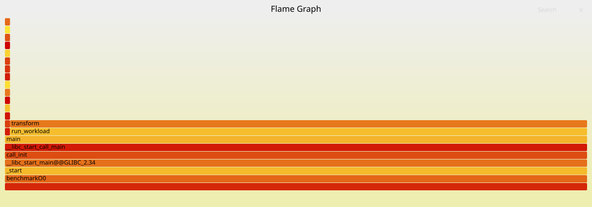
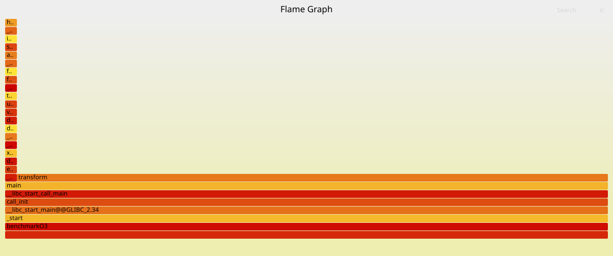

# Лабораторна робота №2. Аналіз продуктивності та енергоспоживання програми

## 1. Мета роботи

Дослідити продуктивність скомпільованої програми мовою C за допомогою інструментів профілювання Linux, побудувати FlameGraph, проаналізувати статистику виконання та енергоспоживання, а також порівняти результати до та після оптимізації компілятором.

У роботі використовуються:
- GCC — компіляція та оптимізація програми;
- `/usr/bin/time` — вимірювання часу та використання ресурсів;
- `perf stat`, `perf record`, `perf report` — аналіз продуктивності;
- FlameGraph — візуалізація стеків викликів;
- HWiNFO — моніторинг енергоспоживання ноутбука.

## 2. Середовище виконання

| Компонент | Характеристика |
|---|---|
| Основна ОС | Windows 11 |
| Віртуальна машина | Oracle VirtualBox |
| Гостьова ОС | Ubuntu 24.04.5 LTS |
| Ядро Linux | 7.0.0-42-generic |
| Компілятор | GCC 13.3.0 |
| perf | 7.0.14 |
| Процесор | AMD Ryzen AI 7 350 |
| Оперативна пам'ять | 32 ГБ |
| PowerTOP | 2.15 |
| HWiNFO | 8.54 |

Профілювання та компіляція виконувалися в Ubuntu, а оцінювання енергоспоживання — засобами HWiNFO у Windows 11.

## 3. Опис досліджуваної програми

Для аналізу використано програму `benchmark.c`, яка виконує обчислення над масивом 32-бітних цілих чисел.

Програма містить чотири основні функції:

- `initialize()` — заповнює масив початковими значеннями.
- `transform()` — виконує множення, додавання та побітові операції над елементами масиву.
- `run_workload()` — багаторазово викликає функцію перетворення.
- `checksum()` — обчислює контрольну суму результатів.

Параметри програми:
- Кількість елементів масиву: 1 048 576.
- Кількість раундів перетворення: 1000.
- Розмір масиву: 4 МіБ.

Основне обчислювальне навантаження зосереджене у функції `transform()`.

### Компіляція

Без оптимізації:

```bash
gcc -O0 -g -fno-omit-frame-pointer benchmark.c -o benchmarkO0
```

З оптимізацією:

```bash
gcc -O3 -g -fno-omit-frame-pointer benchmark.c -o benchmarkO3
```

Після запуску обидві версії вивели однакову контрольну суму:

```text
Checksum: 2252305423525008
```

Отже, оптимізація не змінила результат обчислень.

## 4. Вимірювання часу виконання

Для вимірювання часу та використання системних ресурсів застосовано:

```bash
/usr/bin/time --verbose ./benchmarkO0
/usr/bin/time --verbose ./benchmarkO3
```

### Результати

| Показник | -O0 | -O3 |
|---|---:|---:|
| Real time | 1,83 с | 0,60 с |
| User time | 1,80 с | 0,57 с |
| System time | 0,03 с | 0,03 с |
| CPU usage | 99% | 99% |
| Maximum resident set size | 5476 КіБ | 5476 КіБ |
| Major page faults | 0 | 0 |
| Minor page faults | 1096 | 1098 |
| Voluntary context switches | 0 | 1 |
| Involuntary context switches | 2 | 3 |

### Аналіз

Після застосування оптимізації `-O3` час виконання зменшився з 1,83 до 0,60 секунди.

Прискорення:

**Speedup = 1,83 / 0,60 = 3,05 раза.**

Скорочення часу виконання становить приблизно **67,2%**.

Максимальне використання оперативної пам'яті залишилося однаковим. Отже, оптимізація суттєво вплинула на швидкість обчислень без помітного збільшення використання пам'яті.

Наведені значення отримано під час окремих запусків у VirtualBox, тому вони можуть дещо змінюватися залежно від навантаження системи.

## 5. Аналіз за допомогою perf stat

Для збору статистики використовувалися команди:

```bash
sudo perf stat -d ./benchmarkO0
sudo perf stat -d ./benchmarkO3
```

### Результати

| Показник | -O0 | -O3 |
|---|---:|---:|
| Time elapsed | 1,893 с | 0,540 с |
| Task-clock | 1869,77 мс | 536,47 мс |
| Context switches | 13 | 2 |
| CPU migrations | 0 | 0 |
| Page faults | 1084 | 1084 |
| User time | 1,808 с | 0,529 с |
| System time | 0,065 с | 0,010 с |
| CPU cycles | Not supported | Not supported |

За результатами `perf stat`, оптимізована версія виконувалася приблизно у **3,51 раза швидше**.

Процесорний час суттєво скоротився, тоді як кількість помилок сторінок залишилася однаковою.

Апаратний лічильник `cpu-cycles` був недоступний через обмеження віртуалізації VirtualBox. Тому аналіз проводився на основі доступних програмних лічильників.

## 6. Профілювання за допомогою perf record та perf report

Для запису профілів виконання:

```bash
sudo perf record -e cpu-clock -F 99 -g -o perf_O0.data -- ./benchmarkO0

sudo perf record -e cpu-clock -F 99 -g -o perf_O3.data -- ./benchmarkO3
```

Для перегляду результатів:

```bash
sudo perf report -i perf_O0.data --stdio --no-children

sudo perf report -i perf_O3.data --stdio --no-children
```

### Результати

| Показник | -O0 | -O3 |
|---|---:|---:|
| Кількість samples | 115 | 51 |
| Частка вибірок у transform() | 99,13% | 98,04% |
| Частка вибірок у коді ядра | 0,87% | 1,96% |
| Lost samples | 0 | 0 |

### Аналіз

Майже всі зразки процесорного часу припадають на функцію `transform()`.

У версії `-O0` її частка становить 99,13%, а у версії `-O3` — 98,04%.

Це підтверджує, що `transform()` є основною обчислювальною частиною програми.

Попри близькі відсоткові значення, оптимізована версія працює значно швидше. Відсотки у `perf report` показують розподіл вибірок усередині окремого запуску, а не абсолютний час виконання функцій.

## 7. Побудова FlameGraph

Для візуалізації результатів профілювання використано FlameGraph Брендана Грегга.

Завантаження інструментів:

```bash
git clone https://github.com/brendangregg/FlameGraph.git
```

Побудова графіка без оптимізації:

```bash
sudo perf script -i perf_O0.data | ./FlameGraph/stackcollapse-perf.pl | ./FlameGraph/flamegraph.pl > flame_O0.svg
```

Побудова графіка після оптимізації:

```bash
sudo perf script -i perf_O3.data | ./FlameGraph/stackcollapse-perf.pl | ./FlameGraph/flamegraph.pl > flame_O3.svg
```

### FlameGraph без оптимізації



На графіку видно основний стек викликів:

`main → run_workload → transform`

Майже вся ширина графіка припадає на `transform()`, що свідчить про її домінування у зібраних зразках виконання.

### FlameGraph після оптимізації



Після оптимізації функція `transform()` залишається основним джерелом процесорного навантаження.

Структура стеків дещо змінилася. На оптимізованому графіку також присутній вузький високий стек системних функцій, який займає невелику частину вибірок.

Ширина прямокутників FlameGraph показує частку вибірок, а висота — глибину стеку викликів. Висота не є показником часу.

Оскільки кожен графік нормалізований окремо, прискорення програми визначалося за результатами `time` і `perf stat`.

## 8. Аналіз асемблерного коду

Для порівняння асемблерного коду створено два файли:

```bash
gcc -O0 -S -masm=intel benchmark.c -o benchmark_O0.s

gcc -O3 -S -masm=intel benchmark.c -o benchmark_O3.s
```

Порівняння:

```bash
diff -u benchmark_O0.s benchmark_O3.s | less
```

### Основні відмінності

| Характеристика | -O0 | -O3 |
|---|---|---|
| Обробка масиву | Послідовна | SIMD-векторизація |
| Використання регістрів | Часті звернення до стеку | Активніше використання регістрів |
| Арифметичні операції | Скалярні | Частково векторні |
| Організація циклів | Без оптимізації | Оптимізована |
| SIMD | Не виявлено в основному циклі | SSE2 |

### Приклад без оптимізації

```asm
mov eax, DWORD PTR [rax]
imul eax, eax, 1664525
```

Обчислення виконуються над окремими 32-бітними значеннями.

### Приклад після оптимізації

```asm
movdqu xmm1, XMMWORD PTR [rax]
pslld xmm2, 2
paddd xmm2, xmm1
psrld xmm1, 13
pxor xmm0, xmm1
movups XMMWORD PTR -16[rax], xmm0
```

У версії `-O3` компілятор використовує 128-бітні регістри `xmm`.

Це дозволяє виконувати однотипні операції над чотирма 32-бітними елементами одночасно.

Виявлені інструкції належать до SSE/SSE2, а не AVX. Оскільки в умові завдання зазначено «AVX, якщо застосовно», цей приклад демонструє застосування SIMD без твердження про використання AVX.

### Висновок

Компілятор скоротив кількість допоміжних операцій, оптимізував роботу з регістрами та застосував векторизацію циклу обчислень.

Ці зміни є важливими чинниками прискорення програми.

## 9. Аналіз енергоспоживання

### Методика

Оскільки дослідження проводилося у VirtualBox, апаратні лічильники енергії Linux були недоступні.

PowerTOP дозволив отримати інформацію про активність системи, але не надав числових значень енергоспоживання.

Тому для оцінювання було використано HWiNFO у Windows 11.

Ноутбук працював від батареї. Для зменшення впливу короткої тривалості запуску програма виконувалася багаторазово:

- `benchmarkO0` — 60 запусків;
- `benchmarkO3` — 180 запусків.

Для кожного режиму аналізувалася середня потужність розряджання батареї.

### Отримані результати

| Режим | Середня потужність |
|---|---:|
| Система без тестового навантаження | 7,577 Вт |
| Під час тестування -O0 | 11,532 Вт |
| Під час тестування -O3 | 11,165 Вт |

### Оцінка додаткової потужності

Для версії `-O0`:

3,955 Вт = 11,532 − 7,577.

Для версії `-O3`:

3,588 Вт = 11,165 − 7,577.

Отримані значення характеризують орієнтовне збільшення потужності ноутбука під час тестів порівняно з фоновим режимом.

Це не пряме вимірювання потужності окремого процесу, оскільки враховує також VirtualBox, Windows та інші компоненти.

### Оцінка енерговитрат

Енергію можна оцінити за формулою:

**E = P × t**

де:
- E — енергія, Дж;
- P — середня потужність, Вт;
- t — час, с.

Використовуючи виміряні середні потужності системи та час окремих запусків з `/usr/bin/time`, отримуємо орієнтовні значення:

| Показник | -O0 | -O3 |
|---|---:|---:|
| Середня потужність системи | 11,532 Вт | 11,165 Вт |
| Час одного запуску | 1,83 с | 0,60 с |
| Оцінка енергії системи | 21,10 Дж | 6,70 Дж |

За цією розрахунковою моделлю енергія, витрачена ноутбуком протягом одного запуску, зменшується приблизно на 68%.

**Обмеження методики:** це непряма оцінка. Для енерговитрат використано середню потужність під час серії запусків та час окремого запуску. Не було проведено безпосереднього синхронізованого вимірювання енергії кожної програми.

Також не можна точно відокремити енергоспоживання самої програми від накладних витрат віртуалізації.

Отже, результати демонструють тенденцію до зменшення енерговитрат після оптимізації, але не є точним апаратним вимірюванням енергії процесу.

## 10. Підсумкове порівняння

| Показник | -O0 | -O3 |
|---|---:|---:|
| Час виконання за time | 1,83 с | 0,60 с |
| Час виконання за perf stat | 1,893 с | 0,540 с |
| Процесорний час | 1869,77 мс | 536,47 мс |
| Максимальна RAM | 5476 КіБ | 5476 КіБ |
| Page faults (perf) | 1084 | 1084 |
| Частка transform() у perf report | 99,13% | 98,04% |
| SIMD | Немає в основному циклі | SSE2 |
| Середня потужність ноутбука | 11,532 Вт | 11,165 Вт |
| Розрахункова енергія системи на запуск | ≈21,10 Дж | ≈6,70 Дж |

## 11. Висновки

У ході лабораторної роботи було досліджено вплив оптимізації компілятора на продуктивність скомпільованої програми мовою C.

За допомогою `/usr/bin/time` встановлено, що застосування оптимізації `-O3` скоротило час виконання з 1,83 до 0,60 секунди, забезпечивши прискорення приблизно в 3,05 раза.

Інструмент `perf stat` підтвердив суттєве зменшення процесорного часу. За допомогою `perf record` і `perf report` визначено, що основне обчислювальне навантаження припадає на функцію `transform()`.

Побудовані FlameGraph дозволили візуалізувати стеки викликів та порівняти структуру виконання до і після оптимізації.

Аналіз асемблерного коду показав, що компілятор оптимізував роботу з регістрами та застосував SIMD-векторизацію за допомогою інструкцій SSE2.

Вимірювання HWiNFO показали невелике зниження середньої потужності ноутбука під час виконання оптимізованої версії. Розрахункова оцінка також вказує на зменшення енерговитрат завдяки скороченню часу роботи.

Таким чином, оптимізація `-O3` дозволила суттєво підвищити продуктивність програми без збільшення її максимального використання оперативної пам'яті.
